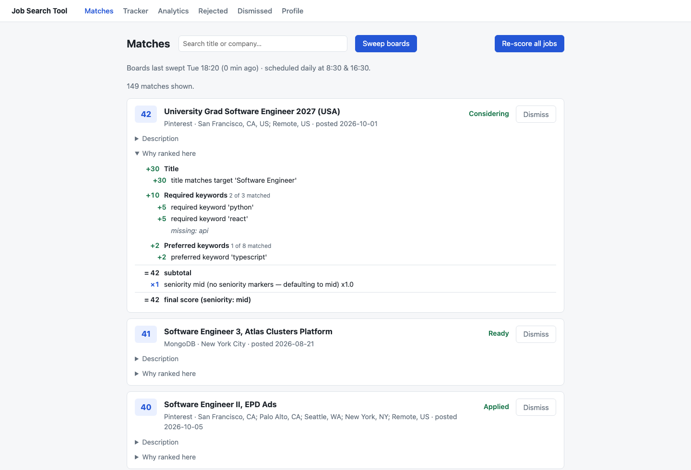
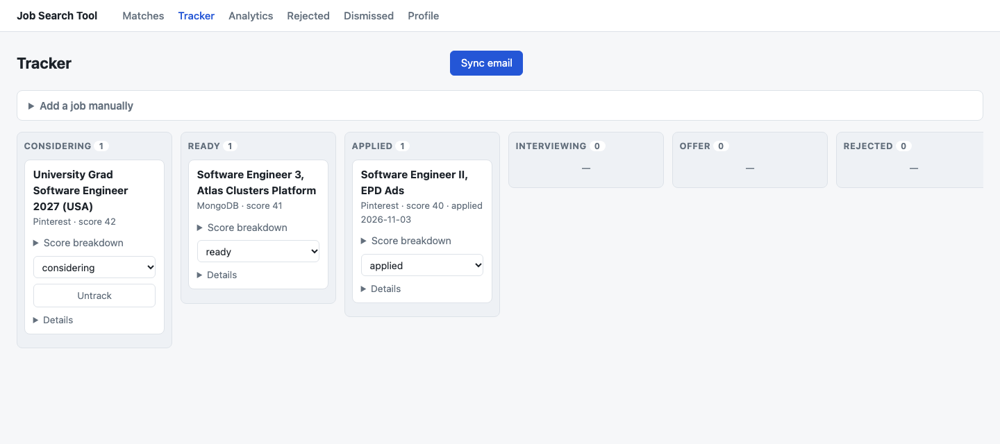

# JobSearcher

[](https://github.com/joshuawalulik/jobsearcher/actions/workflows/ci.yml)
[](LICENSE)

A personal job-search pipeline that scrapes applicant-tracking-system boards,
scores every posting against a keyword profile with a **fully explainable,
deterministic** scoring engine, and tracks applications end to end — from
"new match" through resume tailoring to the reply sitting in your inbox.

Built for one user, running locally: FastAPI + HTMX + SQLite, no ORM, no
Docker, no background queue — just a launchd timer and plain SQL.





## Why it exists

Job boards optimize for engagement, not fit. This tool flips that: you encode
what you actually want once (titles, keywords, locations, seniority,
dealbreakers) in a YAML profile, and the pipeline reads every posting from the
companies you care about and tells you — with a human-readable reason for every
score and every rejection — what's worth your time today.

Two design rules shape everything:

1. **No LLM anywhere in the ranking path.** Scoring is pure functions over
   text. Every run over the same inputs produces the same scores, scoring the
   whole feed costs nothing and takes milliseconds, and no model gets to
   silently change its mind about your career.
2. **Every decision is explainable.** Gate rejections store the reason
   (`"work-type: posting is onsite-only, profile work type is hybrid"`).
   Scores store a categorized breakdown (title match, required/preferred
   keyword coverage with matched *and missing* lists, seniority multiplier,
   experience-demand penalty). The UI shows "why ranked here" on every card.

## What it does

**Scraping** — Pulls jobs from the public JSON APIs of the three major
tech-startup ATS platforms: **Greenhouse**, **Lever**, and **Ashby**. JSON
APIs only — no headless browsers, no HTML parsing arms race. Polite by
construction: 1-second delay between companies, raw responses cached for
debugging. A discovery CLI (`python -m scrapers.discover "Company" --add`)
probes all three APIs with generated slug candidates and appends verified
boards to your profile.

**Gating & scoring** — A two-stage funnel. Stage 1 gates drop hard
disqualifiers (excluded title keywords, location/work-type conflicts,
clearance demands, stale or delisted postings, excessive experience
requirements) without scoring them. Stage 2 scores survivors 0–100: weighted
title match, required/preferred keyword coverage with word-boundary matching
(so `ai` doesn't match "maintain"), negative keywords, a seniority multiplier
derived from the posting's own stated years-of-experience (title markers are
only a fallback), and a per-year penalty for experience demands beyond yours.
Edit the profile in the UI, hit re-score, and the whole feed re-ranks
instantly.

**Tracking** — A kanban-style tracker (considering → ready → applied →
interviewing → offer, with rejected/skipped as terminal lanes) with full event
history, notes, dismissed-with-restore, manual job entry with auto-prefill
from a pasted Greenhouse/Lever/Ashby posting URL, and per-application detail
modals.

**Inbox sync** — Reads your Gmail over IMAP (app password, stdlib `imaplib`)
and matches recruiter email to tracked applications. Classification is the
same philosophy as scoring: deterministic phrase-bucket scoring
(rejected/offer/interviewing) over quote-stripped bodies, with the full
reasoning stored. It **suggests** lane moves on the tracker card — one click
to accept, never auto-moves. Accepted and saved replies become the
application's reply history.

**Resume pipeline** — A YAML → DOCX/PDF renderer that produces a tightly
specified single-page layout (explicit docDefaults so Word, Google Docs, and
LibreOffice don't substitute their own spacing), plus a deterministic style
checklist (em dashes, bullet shape, summary length). A staging CLI
(`python -m apply_run`) tracks a posting, lays out per-company application
folders, versions resume filenames, and moves lanes as you go.

**Adversarial resume review** — The repo ships a [Claude Code
skill](.claude/skills/apply/SKILL.md) that runs the whole application
workflow, with a review gate between drafting and rendering: the draft fans
out to **three parallel read-only reviewer agents** with
[adversarial prompts](.claude/skills/apply/reviewers.md) —
a *truth auditor* (every claim must trace to your master resume bank;
untraceable claims become questions for you, never silent rewrites), a
*hiring-manager simulator* (cold 60-second screen against the JD, default
"pass"), and an *ATS/language reviewer* (keyword gaps + templated phrasing,
explicitly barred from re-checking what the deterministic checker covers).
Findings merge into one punch list you accept or reject item by item before
a single line of the resume changes. The AI drafts and critiques; the human
decides; the deterministic checker gets the last word.

**Analytics** — Read-only SQL over your own funnel: reached-stage
conversions, reply rate by score band, outcomes by resume version, the
applied-within-48h effect, and which keywords correlate with advancing.

**MCP server** — `mcp_server.py` exposes the tracker to Claude (or any MCP
client) over stdio: list jobs in the considering lane, pull a full job
description with its score breakdown, and append workflow notes back to the
tracker card — so an AI assistant can help you tailor applications while the
tracker stays the source of truth.

**Demo mode** — `JOBSEARCHER_DEMO=1` runs the whole app on synthetic data,
so it can be shown publicly without anyone's real job search in it. A
deterministic generator builds a fresh database for the current day (a few
hundred postings, a tracker in every lane, labeled recruiter mail, contacts),
and everything on screen is produced by the real gates, scorer and mail
classifier, never copied in. Visitors read a shared read-only copy; the first
time one changes something, they get a private SQLite copy tied to a cookie,
so nobody sees anyone else's edits. Copies expire when unused, are capped in
number and size, and anything that would reach the network (sweeps, mail
sync, posting lookup) is refused with the reason shown.

**Security** — The app runs in a browser that has every other site open too,
so each request is checked: a host allow-list (DNS rebinding), a
fetch-metadata cross-site check on every write (CSRF, with no tokens in
forms), body, query and per-field size limits, and a strict Content Security
Policy with no inline scripts, handlers or styles anywhere. Stored links are
limited to http(s). Dependencies are pinned with hashes, and CI runs the
tests plus `pip-audit`, `bandit` and CodeQL on every pull request.

**Automation** — A launchd agent runs sweep + re-score + email sync twice a
day; every run is recorded in a `sweep_runs` table and the latest summary
shows in the feed header. The same code path backs the "Sweep boards" button
in the UI.

## Architecture

```
profile.yaml ──► scrapers/ ──► SQLite (jobs.db) ──► scoring/ ──► FastAPI + HTMX UI
  keywords        greenhouse      plain SQL, no ORM    gates.py      feed / tracker /
  weights         lever           raw JSON cached      score.py      analytics / profile
  gates           ashby                                 (pure fns)         editor
  watchlist
                  email_sync.py ──► suggestions ──► tracker lanes
                  (IMAP, deterministic phrase buckets)

                  mcp_server.py ──► Claude / MCP clients (reads jobs.db directly)
                  resume_build.py ──► DOCX + PDF from YAML
```

~10k lines of Python, a test suite covering the scrapers (against fixture
boards), every gate and scoring rule, the FastAPI routes, email
classification, the resume renderer, the MCP server, the request checks and
the demo sandboxes.

## Running it

Requires Python 3.12.

```bash
git clone https://github.com/joshuawalulik/jobsearcher && cd jobsearcher
python3.12 -m venv .venv && source .venv/bin/activate
pip install --require-hashes -r requirements.txt -r requirements-dev.txt

cp config/profile.example.yaml config/profile.yaml   # then make it yours
python -m scrapers.sweep        # first sweep (the example profile watches a few well-known boards)
uvicorn app:app --reload        # http://127.0.0.1:8000
```

Or look around first, with nothing to configure and nothing real in it:

```bash
JOBSEARCHER_DEMO=1 uvicorn app:app   # synthetic data, built on startup
```

Run the tests:

```bash
pytest
```

`requirements.txt` (runtime) and `requirements-dev.txt` (adds pytest) are
compiled from the matching `.in` files with `uv pip compile
--generate-hashes`; the exact commands are at the top of `requirements.in`.

Optional pieces:

- **Email sync** — `cp config/secrets.yaml.example config/secrets.yaml`, add a
  Gmail app password, set `email.enabled: true` in your profile.
- **Scheduled sweeps** — adapt `launchd/com.jobsearcher.sweep.plist` (macOS)
  or cron `python -m autosweep`. launchd can't expand `~`, so replace the
  `/Users/you/jobsearcher` placeholder paths with your real clone path
  before loading the plist.
- **MCP** — register `mcp_server.py` with your MCP client;
  `install_desktop_connector.py` automates it for Claude Desktop (see
  `claude-desktop-connector.md`).

## Design notes

- **SQLite + plain SQL.** Single user, local disk: an ORM buys nothing here.
  Schema migrations are additive `ALTER TABLE`s or table rebuilds inside
  `init_db()`, so a fresh clone and a year-old database both come up current.
- **HTMX over a SPA.** Every interaction is a server-rendered fragment swap.
  No build step, no client state to desync from the database.
- **Config over code.** Every tunable — keywords, weights, gate thresholds,
  email phrase buckets, analytics bands — lives in `profile.yaml`. The
  watchlist is editable from the UI; comment-preserving round-trip writes via
  `ruamel.yaml`.
- **Honest failure modes.** Scraper errors land in the sweep log and the
  sweep summary UI, never swallowed. A posting that disappears from its board
  gets gate-rejected as delisted (dead link) and self-heals if relisted.

## Non-goals

Multi-user, auth, deployment, Workday/Taleo scraping (no public JSON APIs),
and LLM-based ranking. The last one is a feature: an LLM can help you *apply*
(that's what the MCP server is for) — it doesn't get to decide what you see.

## A note on the history

This repo is the scrubbed public mirror of a private repo that holds my real
profile and application data, so its commit log starts at the first public
release rather than at the project's beginning. Features land here as one
branch/PR per feature after they ship privately.
